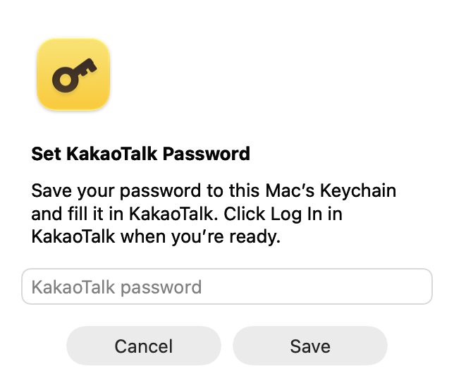

# Talk Password Fill

A desktop utility for macOS and Windows that fills the password field in the official KakaoTalk app. You click **Log In** yourself.

  
  

## What it looks like

*The actual macOS setup dialog before a password is entered.*

## Quick start

### macOS 13 or later

1. If upgrading, quit the old helper. Unzip the download, move **Talk Password Fill** to **Applications**, and open it.
2. Enable **Talk Password Fill** in **System Settings → Privacy & Security → Accessibility**. Save your KakaoTalk password if prompted.
3. Bring the KakaoTalk login window to the front. Once the helper fills the field, click **Log In**. Enable **Launch at Mac Login** from the **Talk Fill** menu to start the helper automatically.

The preview is ad hoc signed. macOS may show a first-launch prompt. [Apple app-opening guide](https://support.apple.com/102445)

If autofill stops after an update and **Talk Password Fill** is already enabled in Accessibility, remove the old entry and add the current app from **Applications** using **+**.

### Windows 11 x64

1. If upgrading, quit the old helper from the notification area. Use **Extract All** and keep the extracted files together in a permanent folder.
2. Open **TalkPasswordFill.exe** and click **Save settings** with **Launch at Windows sign-in** selected. Leave the password box blank if a saved password already exists.
3. Open the KakaoTalk login window. The helper shows its status in settings. When prompted, clear KakaoTalk’s password field and click **Fill now** in the helper. Click **Log In** in KakaoTalk when ready.

The Windows preview is unsigned. Live validation of autofill after Windows sign-in and after KakaoTalk logout is pending. [Windows verification checklist](windows/README.md)

## Security and privacy

- macOS Keychain and Windows DPAPI encrypt saved passwords at rest. Each user registers their own password on each computer.
- The helper verifies the KakaoTalk process and fills a supported, empty password field. The password is read into memory for that operation. It stays off the clipboard and out of logs and network requests.
- The current preview supports one KakaoTalk password per OS user. It does not match the account ID in the login window.

## Project layout

| Folder | Contents |
| --- | --- |
| [`macos/`](macos/) | Swift menu bar app, bundle resources, and build script |
| [`windows/`](windows/) | C# tray app, project file, and on-device test steps |
| [`docs/`](docs/) | Download artwork and a native macOS screenshot |

## License

[BSD Zero Clause (0BSD)](LICENSE). Anyone may use, copy, modify, or redistribute this project's code, including commercially, without attribution or prior permission.

Talk Password Fill is an independent utility. KakaoTalk is a product of Kakao Corp.
